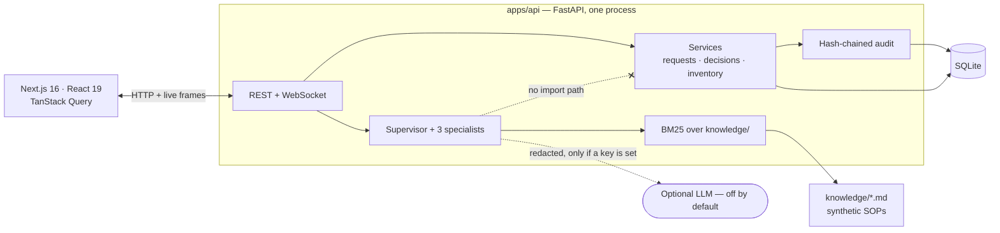

# aether-eoc-reference

**A reference slice of a next-generation public-health Emergency Operations
Centre.** A live ICS incident board, resource requests with real contention,
human-in-the-loop AI agents that cannot execute anything, and an append-only
hash-chained audit log.

> **SYNTHETIC DEMO — not a live EOC.**
>
> This repository is a public reference slice. It is not an official system of
> the Dubai Health Authority or any government. It contains no live incident
> data, no patient data, and no production credentials. Every fixture is
> invented for this demonstration — not anonymised, *invented*. The demo
> passwords below are public by design and must never be reused anywhere real.

```
Runs with no API key.  make install && make seed && make dev  →  http://localhost:3000
```

---

## What this is

Three verticals, deep rather than broad:

**A live incident board.** One active incident with ICS-aligned sections, an
operational-period clock, KPIs that each have an action behind them, an
append-only activity stream, and presence. Posting a log note is optimistic; the
server stays the source of truth.

**Resource requests with genuine contention.** A lifecycle
(`draft → submitted → recommended → approved | modified | rejected → tasked →
fulfilled`) whose legal transitions live in one table and are returned by the
API, so the UI renders the server's rules rather than a copy of them. The seeded
scenario contains a shortage that *cannot* be cleanly filled.

**AI orchestration that stops.** A supervisor routes an intent to one of three
narrow specialists. Anything that would move resources is written as
`awaiting_human` and held. **No agent module imports the inventory service** —
the guardrail is a property of the import graph, not a promise.

## What this is not

Not a product, not a deployment, not a sanitised copy of anything real. No
FHIR/HIE adapters, no agency identity provider, no GIS, no multi-tenancy, no
autonomous execution, ever. `docs/PRODUCT.md` lists the non-goals; the ADRs
explain what was cut and why.

## Legacy WebEOC-class problems this attacks

| Problem | What this slice does |
|---|---|
| **Collaboration is not really shared.** Boards are forms over a database; you find out something changed when you refresh | WebSocket board with presence. Frames are *hints* — the client refetches over REST, so a dropped frame can never leave the board showing something the server never said |
| **Workflow is rigid but not enforced.** The real lifecycle lives in training and convention, not in the system | One transition table; illegal moves return **409** with the permitted set; the request detail timeline is rendered *from the audit log* |
| **AI arrives without guardrails.** "The system spots a shortage and moves the resources" | Agents propose; only a human with ICS authority commits. The equity floor is re-checked against live stock at execution time, and only an Incident Commander may override it — with a written reason, recorded |
| **The audit trail answers the wrong question.** A `last_modified_by` column tells you who was logged in, not why | Hash-chained append-only log linking the AI suggestion, the human decision, and the stock movement by correlation id — with `GET /api/audit/verify` so "immutable" is a claim you can test |

## Architecture



Full container and sequence diagrams: [`docs/ARCHITECTURE.md`](docs/ARCHITECTURE.md).

## Quick start

Requires **Node 22.12+** and **Python 3.12** (via [uv](https://docs.astral.sh/uv/)).
No database server, no API key, no accounts.

> Node 22.12 is the floor because the test runner's jsdom dependency is
> ESM-only and needs `require(esm)`, which Node enabled by default in
> 22.12. There is an `.nvmrc`, so `nvm use` picks a working version.

```bash
git clone https://github.com/AliDousa/aether-eoc-reference.git
cd aether-eoc-reference
cp .env.example .env

make install     # uv sync + npm install
make seed        # build data/eoc.db and load the heat-surge scenario
make dev         # API on :8080, web on :3000
```

Open <http://localhost:3000>.

<details>
<summary><b>Without GNU make</b> (Windows, or a bare shell)</summary>

```bash
# API
cd apps/api
uv sync
uv run python -m app.seed --reset
uv run uvicorn app.main:app --reload --port 8080

# Web, in a second terminal
cd apps/web
npm install
npm run dev
```

Ports are configurable if 3000 or 8080 are taken:

```bash
make dev API_PORT=8090 WEB_PORT=3100
```

The web app reads `NEXT_PUBLIC_API_BASE` / `NEXT_PUBLIC_WS_BASE`, so set those to
match a non-default API port.
</details>

<details>
<summary><b>With Docker Compose</b></summary>

```bash
docker compose up --build     # web on :3000, api on :8080
```

The API seeds itself on first boot and is a no-op on restart, so a reviewer's
demo state survives a container restart.
</details>

### Demo logins

Password is `demo` for all of them. **These are public and fictional. Never reuse
them.**

| Username | ICS role | May approve resource movements? |
|---|---|---|
| `ic.demo` | Incident Commander | Yes — anything, including an equity-floor override |
| `logistics.demo` | Logistics Section | Yes — logistics-scope recommendations |
| `ops.demo` | Operations Section | **No.** Can log and raise requests, cannot commit stock |

Switch roles from the top-right control. It performs a real login, so authority
genuinely changes.

## Demo script

Eight steps, about ten minutes. Full version with expected on-screen results:
[`docs/DEMO_SCRIPT.md`](docs/DEMO_SCRIPT.md).

```
1. Open the app. Confirm the SYNTHETIC DEMO badge and incident HEAT-2026-DUBAI-REF.
2. Switch role to Logistics. Presence updates.
3. Open the Immediate request that cannot be fully filled from one site.
4. Click "Ask recommender". A recommendation appears with equity notes and
   citations. Inventory does not change.
5. Click Modify, reduce a quantity, Approve. Inventory and board update. Audit
   shows the recommendation and the human modification.
6. Switch to IC. Run Situation Assessment. The summary cites activity events and
   knowledge chunks.
7. Ask the Protocol Retriever: "When do we open a second cooling center?"
   Get a cited answer with the verify banner.
8. Open Audit, filter `ai.*` and `inventory.*`. Confirm an unbroken chain.
```

The one-minute version: **step 4 then step 5.** An agent proposes an allocation
across three sites with an explicit 90-unit shortfall and a high-need site
protected at 20 units; inventory does not move. Then a human edits it and
approves, and only then does stock change — writing both a decision row and a
transfer row into a verifiable chain.

## The seeded scenario

`HEAT-2026-DUBAI-REF` — a fictional multi-day heat dome over a large outdoor
event. Cooling centres filling, ORS under contention, two field-epidemiology
teams requested.

On a fresh seed: 6 operators, 4 sites, 12 SKUs, 42 inventory positions, **27
activity entries** across six hours, 5 requests (3 open including one IMMEDIATE
with a shortfall, 1 approved, 1 rejected with a written reason), 2 agent runs,
and **29 audit rows that verify from genesis**.

The seeder does not insert history rows. It replays `fixtures/timeline.json`
through the same service functions the running application uses, so the seeded
audit log is genuine and the demo cannot drift from real behaviour.

## Running with a model (optional)

The default is `LLM_PROVIDER=none`, and everything above works in that mode. To
let the two *narrative* agents write their prose with a model:

```bash
LLM_PROVIDER=anthropic
LLM_API_KEY=sk-...
LLM_MODEL=claude-sonnet-5
```

The Resource Recommender stays deterministic either way — an allocation is
arithmetic against a written rule, and a model would add variance without adding
correctness. Redaction runs before every outbound call, with a tripwire that
refuses to send if anything identifier-shaped survives it. Any failure degrades
silently to fixture mode. See [`docs/AI_SPEC.md`](docs/AI_SPEC.md).

## Tests

32 tests, none of which need an API key:

```bash
make test          # 18 API (pytest) + 14 web (vitest)
make lint          # ruff + eslint
make typecheck     # pyright + tsc
```

The load-bearing assertions: a recommendation does not mutate inventory; the
approve path mutates exactly once and writes both a decision row and a transfer
row; the equity check fails closed when the only source is a high-need site;
every citation an agent emits resolves to a real chunk on disk; Operations
cannot commit resources; unauthenticated writes are rejected across every
mutating endpoint.

## Documentation

| Document | What it covers |
|---|---|
| [`docs/PRODUCT.md`](docs/PRODUCT.md) | The problem, the ICS users, the slice scope, explicit non-goals |
| [`docs/ARCHITECTURE.md`](docs/ARCHITECTURE.md) | Containers, the approve path in sequence, failure modes, known limits |
| [`docs/AI_SPEC.md`](docs/AI_SPEC.md) | One contract per agent: will / will not, I/O schemas, guardrails, fallbacks |
| [`docs/THREAT_MODEL.md`](docs/THREAT_MODEL.md) | Why this is safe to publish, and the demo-only weaknesses named out loud |
| [`docs/DEMO_SCRIPT.md`](docs/DEMO_SCRIPT.md) | The eight steps with expected results |
| [`docs/adr/`](docs/adr) | Six ADRs on the decisions that were actually hard |

The ADRs are the part worth reading if you only read one thing:
[modular monolith](docs/adr/0001-modular-monolith-reference-slice.md) ·
[SQLite default](docs/adr/0002-sqlite-default-postgres-optional.md) ·
[WebSockets](docs/adr/0003-websockets-for-live-board.md) ·
[append-only audit](docs/adr/0004-append-only-audit-log.md) ·
[supervisor + HITL](docs/adr/0005-supervisor-specialist-agents-with-hitl.md) ·
[synthetic data only](docs/adr/0006-synthetic-data-only-public-release.md)

## How this relates to `phim`

[`phim`](https://github.com/AliDousa/phim) is the modelling half — epidemiological
forecasting, SEIR and agent-based models, calibration. It answers *what is likely
to happen*.

This repository is the operations half. It answers *what are we doing about it,
who decided, and on what basis*. A forecast is an input to an incident action
plan, not a substitute for one; the failure mode of merging them is a system that
presents a model output as a decision.

Neither repository contains production code.

## Screenshots

Not committed. `docs/images/` explains why and how to generate your own — a
screenshot of a synthetic demo ages badly and adds nothing a reviewer cannot see
by running it, which takes about two minutes.

## Security and synthetic data

- Every fixture is invented. No real people, places, incidents, patients, or
  agencies. Names are role-shaped labels (`IC-Demo`, `LOGISTICS-1`,
  `Operator North`).
- The SOP corpus in `knowledge/` was written for this repository and carries
  `DEMO PROTOCOL — not official guidance.` on every file.
- Every data file carries a `SYNTHETIC FIXTURE — not operational data` banner.
- With `LLM_PROVIDER=none` the application makes no outbound request at all.
- Demo passwords are published deliberately; see [`SECURITY.md`](SECURITY.md).

## Licence

[Apache-2.0](LICENSE). Built by [Ali Dousa](https://github.com/AliDousa).
Contributions: see [`CONTRIBUTING.md`](CONTRIBUTING.md) — PRs adding production
integrations will be declined, and the reasoning is there.
