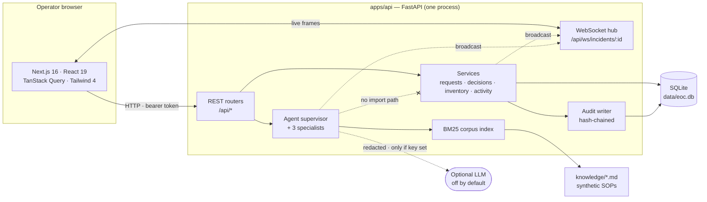
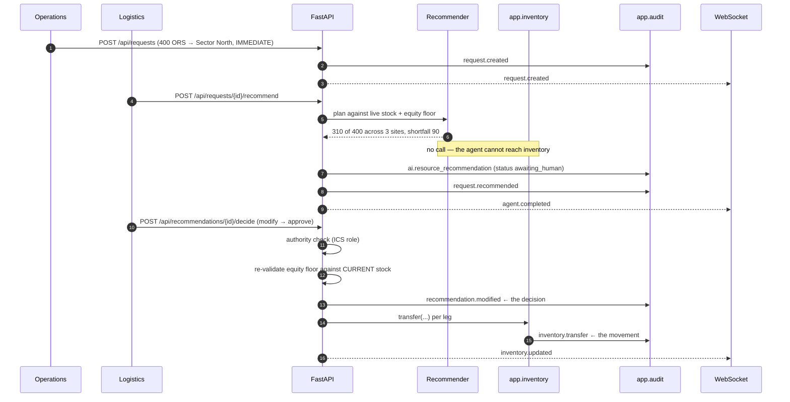

# Architecture

> **Synthetic demonstration.** No production integrations, no live data.

Two processes, one database, no broker. The shape is argued in
[ADR-0001](adr/0001-modular-monolith-reference-slice.md).

## Containers



The dashed crossed edge is the load-bearing one: **no agent module imports the
inventory service.** "The AI cannot move stock" is a property of the import
graph, checkable with grep, not a policy someone has to remember.

## The path that matters

Approving a recommendation is the only route from an AI suggestion to a stock
movement. It is worth following once.



Four properties of that sequence are deliberate:

1. **The equity floor is re-evaluated at execution time**, against current stock
   — not trusted from the proposal. A human edit gets the same scrutiny as a
   generated plan, and a stale plan cannot slip through.
2. **The decision row is written before the movement**, in the same transaction.
   If a transfer fails, both roll back, and the log never claims a decision that
   produced nothing.
3. **`app.inventory.transfer` is the only writer of stock**, and it always writes
   its audit row itself.
4. **Broadcasts cannot fail the write.** They go through `safe_broadcast`, which
   suppresses everything.

## Data flow for reads

The board is one endpoint (`GET /api/incidents/current`) rather than five,
because it is read on a timer and after every WebSocket hint. Assembling it
server-side stops the client from fanning out four requests and then reconciling
four slightly different moments in time — on a screen people commit resources
from, that is a correctness concern.

WebSocket frames are **hints**. The client invalidates TanStack Query keys and
refetches over REST; the only payload it trusts from the socket is presence,
which exists nowhere else. See [ADR-0003](adr/0003-websockets-for-live-board.md).

## Module map

```
apps/api/app/
  main.py            FastAPI app, CORS, one DomainError → HTTP translator
  config.py          Settings; resolves relative SQLite paths to the repo root
  models.py          10 SQLAlchemy tables
  types.py           StrEnumType — enums persist as their values
  state_machine.py   Legal request transitions, in one table
  requests.py        Request lifecycle; every state change audited
  inventory.py       THE single stock mutation point
  decisions.py       Human decisions: authority, equity re-check, movement
  audit.py           Append-only hash chain + verification
  activity.py        Incident narrative (audited only for primary actions)
  realtime.py        In-process WebSocket hub + presence
  board.py           Board read model
  rag.py             BM25 over knowledge/
  security.py        Demo auth + the ICS authority table
  seed.py            Replays fixtures/timeline.json through the real services
  agents/
    supervisor.py    Intent routing, input assembly, persistence, HITL gate
    recommender.py   Allocation planner + equity floor (pure functions)
    situation.py     SITREP-shaped summary; uncertainty is mandatory
    protocol.py      Cited answers from the corpus, or "I don't know"
    redact.py        Names → role tokens, then pattern scrubbing
    llm.py           Optional model path; degrades to fixture mode on any failure
```

## Failure modes

Stated because a reference implementation that only describes the happy path is
not much of a reference.

| Failure | Behaviour | Why |
|---|---|---|
| **No LLM key** (the default) | Everything works. Agents produce deterministic rule-derived output; the Agents page shows `AI · rules` | Fixture mode is the default, not a fallback (ADR-0005) |
| **LLM times out or errors** | Silently degrades to fixture mode; the run records `mode: fixture` | An EOC tool must not break because a vendor endpoint is slow |
| **Redaction tripwire fires** | The call is not made; fixture mode is used | Better to lose prose quality than to leak |
| **WebSocket drops** | Header shows "Offline — polling" **in words**; a 20s refetch keeps the board correct; the client reconnects every 3s | A board that silently stops updating is more dangerous than one that never updated |
| **Broadcast fails mid-write** | The write still commits | `safe_broadcast` suppresses; the client refetches anyway |
| **API is down** | The board shows how to start it and seed it | Empty states should teach, not stare |
| **Equity floor breached by an edit** | HTTP 409 with the specific violations; only an IC may override, with a reason | Fails closed |
| **Two approvals race the same stock** | The second fails with `insufficient_stock` before writing anything | `transfer` validates then mutates in one transaction |
| **Audit row tampered with** | `GET /api/audit/verify` reports the first divergent sequence number | Hash chain (ADR-0004) |

### Known limits

These are real and are not worked around:

- **A second API replica breaks fan-out and forks the audit chain.** The hub is
  in-process and chain appends are serialised by an `asyncio.Lock`. Multi-replica
  needs Redis pub/sub and a database sequence. This is the largest gap between
  this slice and production.
- **The audit log is tamper-*evident*, not tamper-*proof*.** Anyone with database
  write access can recompute the chain. See `docs/THREAT_MODEL.md`.
- **The bearer token lives in `localStorage`** and is passed to the WebSocket as
  a query parameter. Both are demo-only choices, both are documented in the
  threat model with their production replacements.

## Stack

| Layer | Choice | Version at time of writing |
|---|---|---|
| API | FastAPI + Pydantic v2 | 0.141 / 2.13 |
| Runtime | Python + uv | 3.12 |
| ORM | SQLAlchemy async | 2.0 |
| Store | SQLite (Postgres optional) | aiosqlite |
| UI | Next.js App Router | 16.3 |
| React | React | 19.2 |
| Styling | Tailwind CSS (CSS-first config) | 4.3 |
| Data | TanStack Query | 5 |
| Forms | React Hook Form + Zod | 7 / 4 |
| Charts | Recharts | 3 |
| Tests | pytest + Vitest / Testing Library | 28 tests |

Deviations from the intended stack, with reasons, are recorded in ADR-0001
(TanStack Table, npm over pnpm) and in `tests/web/README.md` (web test location).

## Where generated types would help

Client types are hand-written in `apps/web/lib/types.ts`. The API is small and
stable, and an OpenAPI generation step is one more thing a reviewer would have
to run before the repo makes sense. If the surface grew past roughly a dozen
endpoints, generating from `/api/openapi.json` would become the right call —
the schema is already published and accurate.
